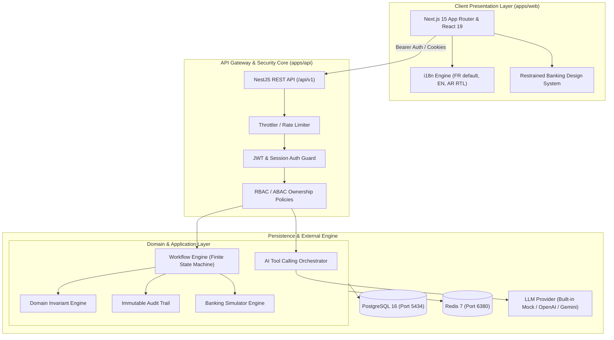
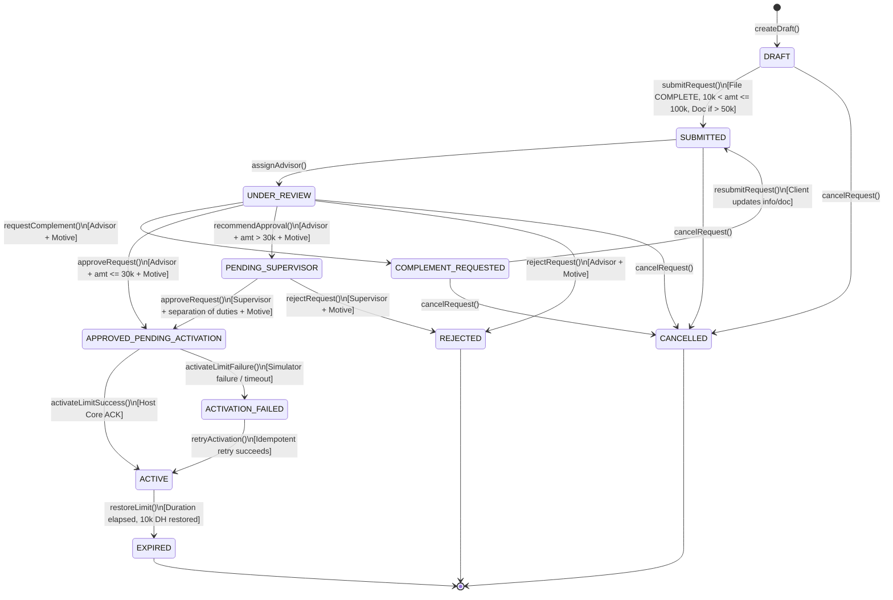
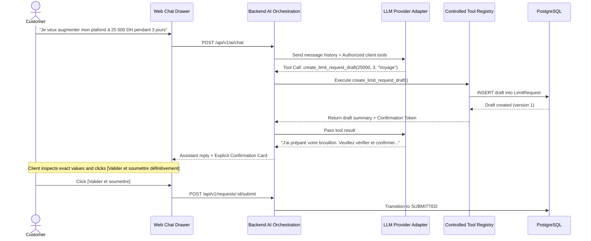

# PROORGA — AI-Powered Banking Workflow Platform
### Temporary Transfer Limit Increase Engine with Multi-Tier Approvals & Controlled Agent Tools


---

## 1. Project Overview

The **PROORGA Banking Workflow Platform** is an enterprise-grade banking application designed to handle customer requests for a **temporary transfer limit increase** (*augmentation temporaire de plafond de virement*).

The system models a retail banking workflow featuring:
1. **Three strictly isolated roles:** Customer (*Client*), Banking Advisor (*Conseiller*), and Risk Supervisor (*Superviseur*).
2. **Deterministic Banking Business Rules & Governance:** Approval thresholds (≤ 30,000 DH for advisors, > 30,000 DH escalated to supervisor), mandatory supporting documents (> 50,000 DH), customer file completeness checks, single-active-request invariants, and cryptographic separation of duties.
3. **Simulated Banking Core with Idempotent Recovery:** Complete separation of approval and activation, deterministic failure injection modes (`NETWORK_TIMEOUT`, `LOST_ACK`, `BANK_500`), and automatic limit expiration with baseline restoration (10,000 DH).
4. **Controlled AI Banking Assistant:** An AI agent capable of inspecting permitted banking data and preparing drafts via server-side tools, requiring **explicit confirmation** before submission, with zero direct approval or bypass authority.
5. **Full Internationalization (i18n) & Arabic RTL:** French by default, English, and complete Right-to-Left Arabic layout, typography, and localized currency formatting (`DH` / `MAD` / `د.م.`).

---

## 2. Architecture & Design Principles

The application is structured as a **Modular Monolith** in a strongly-typed TypeScript monorepo using `pnpm workspaces`:



### Monorepo Structure

```text
proorga-ai-banking-agent/
├── apps/
│   ├── web/                    # Next.js 15 App Router frontend application
│   │   ├── src/
│   │   │   ├── app/            # Root layout, globals.css, localized shell
│   │   │   ├── components/     # UI primitives (Card, Button, Modal, StatusBadge)
│   │   │   ├── features/       # Role workspaces: client, advisor, supervisor, ai-chat
│   │   │   ├── i18n/           # Translation dictionaries (fr.json, en.json, ar.json)
│   │   │   └── lib/            # Typed API client
│   │   └── Dockerfile
│   │
│   └── api/                    # NestJS modular backend API
│       ├── src/
│       │   ├── modules/
│       │   │   ├── auth/              # JWT issuance, strategies, password hashing
│       │   │   ├── accounts/          # Accounts, balances, transfer limits
│       │   │   ├── customers/         # Customer profiles & KYC file completeness
│       │   │   ├── requests/          # Request management & queues
│       │   │   ├── workflow/          # Finite State Machine & decisions
│       │   │   ├── banking-simulator/ # Core activation, idempotency, failure modes
│       │   │   ├── documents/         # Uploads, MIME checks, SHA-256 storage
│       │   │   ├── ai/                # LLM provider adapter, controlled tools
│       │   │   ├── audit/             # Structured audit logging
│       │   │   └── health/            # Readiness & health endpoints
│       │   └── main.ts
│       ├── prisma/
│       │   ├── schema.prisma   # PostgreSQL models with Decimal(12,2)
│       │   └── seed.ts         # Realistic multi-role demo seed dataset
│       └── Dockerfile
│
├── packages/
│   ├── shared-types/           # TypeScript enums, models, and API interfaces
│   └── shared-validation/      # Shared Zod schemas (limits, durations, credentials)
│
├── docs/                       # Formal design documentation
│   ├── REQUIREMENTS.md         # Full traceability matrix from technical assignment PDF
│   ├── ARCHITECTURE.md         # Modular monolith, security, and AI architecture
│   ├── DATABASE.md             # Relational schema specification & ER diagram
│   ├── WORKFLOW.md             # Complete Finite State Machine transition matrix
│   └── IMPLEMENTATION_PLAN.md  # Sequenced phased implementation roadmap
│
├── TASKS.md                    # Detailed progress tracking checklist
├── docker-compose.yml          # Containerized deployment (Postgres, Redis, API, Web)
├── .env.example                # Documented configuration template
└── README.md
```

---

## 3. Strict Banking Workflow & Finite State Machine

The limit increase request lifecycle is governed by an explicit Finite State Machine with optimistic concurrency locking:



---

## 4. Demo Accounts & Credentials

The platform includes a realistic, pre-seeded dataset. All passwords are set to `Password123!` (or click directly in the UI via the **Quick Demo Switcher** dropdown in the top navigation header):

| Role | Name | Email | Password | Specific Features / Test Purpose |
| :--- | :--- | :--- | :--- | :--- |
| **CLIENT** | Karim Alami | `client1@proorga.bank` | `Password123!` | Complete file, 75,450 DH balance, standard 10,000 DH limit. Ideal for standard tests. |
| **CLIENT** | Leila Benjelloun | `client2@proorga.bank` | `Password123!` | Complete file, 142,800 DH balance, pre-existing 65,000 DH request escalated to supervisor. |
| **CLIENT** | Youssef Tazi | `client3@proorga.bank` | `Password123!` | **Incomplete Customer File** (KYC missing). Demonstrates blocked submission rule. |
| **CONSEILLER** | Mehdi Chraibi | `conseiller1@proorga.bank` | `Password123!` | Advisor (Casablanca Portfolio). Delegation authority up to 30,000 DH. |
| **CONSEILLER** | Fatima-Zahra Idrissi | `conseiller2@proorga.bank` | `Password123!` | Advisor (Rabat Portfolio). |
| **SUPERVISEUR** | Omar Berrada | `superviseur1@proorga.bank` | `Password123!` | Risk Supervisor. Validates requests > 30,000 DH. Recommended request S2. |
| **SUPERVISEUR** | Nadia Mansouri | `superviseur2@proorga.bank` | `Password123!` | Risk Supervisor. Enforces **Separation of Duties** test scenarios. |
| **ADMIN** | Tariq Amrani | `admin@proorga.bank` | `Password123!` | System Administrator with omni-access for testing. |

---

## 5. Quick Start Instructions

### Prerequisites
- Node.js >= 20 (Node 22 or 24 recommended)
- `pnpm` >= 9 (or npm)
- Docker & Docker Compose

### Option A: Local Development Setup (Recommended)

1. **Clone & install dependencies:**
   ```bash
   pnpm install
   ```

2. **Start PostgreSQL & Redis background containers:**
   *(Host ports configured: Postgres on 5434, Redis on 6380 to avoid local port conflicts)*
   ```bash
   docker compose up -d postgres redis
   ```

3. **Initialize database schema & run seed script:**
   ```bash
   cp .env.example .env
   cp .env.example apps/api/.env
   pnpm db:generate
   pnpm db:migrate
   pnpm db:seed
   ```

4. **Start the Backend API (Port 4001):**
   ```bash
   pnpm dev:api
   # Swagger docs available at: http://localhost:4001/api/docs
   ```

5. **Start the Frontend Web Application (Port 3002):**
   ```bash
   pnpm dev:web
   # Access application at: http://localhost:3002
   ```

---

## 6. Verification & Automated Acceptance Tests

The test suite validates the business logic and executes all **7 Official Acceptance Scenarios** defined in `CDC-FULL STACK.pdf` (Page 6).

### Run All Unit & Integration Tests:
```bash
# Run banking rules unit tests
pnpm test

# Run the 7 official technical assignment acceptance scenarios (E2E)
pnpm test:e2e
```

### Official Acceptance Scenarios Tested:

| Scenario | Objective | Tested Outcome |
| :---: | :--- | :--- |
| **S1** | **Standard Advisor Flow (25 000 DH / 3 days)** | Client drafts, confirms parameters, submits. Advisor directly approves (≤ 30,000 DH). Limit activates to 25,000 DH. Expiration restores 10,000 DH. |
| **S2** | **Escalated Flow with Complements (60 000 DH)** | Submission without document is blocked. Document uploaded. Advisor issues motivated complement request. Client responds. Advisor recommends. Supervisor approves. Limit activated. |
| **S3** | **Access Control & IDOR Prevention** | Client 1 accessing Client 2 request -> `403 Forbidden`. Advisor attempting to approve > 30,000 DH directly -> `403 Forbidden`. Incomplete file submission -> `400 Bad Request`. |
| **S4** | **Concurrency Protection** | Duplicate concurrent submissions on the same account -> rejected with `409 Conflict`. Concurrent decisions on stale version -> rejected with `409 Version Conflict`. |
| **S5** | **Failure Recovery & Idempotent Retry** | Simulator activation network failure records `ACTIVATION_FAILED`. Subsequent retry using the same idempotency key activates cleanly with zero duplicate operations. |
| **S6** | **Cancellation Before Decision** | Client cancels submitted request before advisor decision. Subsequent review attempt by advisor on stale screen is rejected with `409 / 400`. |
| **S7** | **AI Safety & Graceful Fallback** | Prompt injection attempting to bypass rules or force approval is neutralized. Disconnecting AI leaves manual forms 100% operational. |

---

## 7. AI Assistant & Controlled Tool Calling

The AI Assistant follows a **Controlled Server-Side Tool Calling Architecture**:



### Safety Features:
- **Zero Approval Authority:** The AI agent cannot approve requests or activate limits.
- **Server-Derived Identity:** Identity is extracted strictly from the authenticated JWT session, never from model arguments.
- **Explicit Confirmation Card:** A conversation alone does not constitute a submission. An unmissable Confirmation Card with cryptographic hash of parameters is rendered for explicit customer confirmation.
- **Offline Mock Provider:** Built-in deterministic mock provider allows running the application and all tests offline with zero API keys required. External OpenAI/Anthropic/Gemini keys can be configured via `.env`.

---

## 8. Internationalization (i18n) & Arabic RTL Support

The application delivers a localized financial SaaS experience:

- **Default Language:** French (`fr`) is the primary default across the platform.
- **English (`en`)** and **Arabic (`ar`)** are supported with dynamic switching from the top header.
- **Full Arabic RTL:**
  - Automatic `dir="rtl"` applied to document root.
  - Logical CSS properties throughout layout (`ms-*`, `me-*`, `start-*`, `end-*`, `text-start`).
  - Arabic typography via Cairo / IBM Plex Sans Arabic.
  - Locale-aware currency formatting (`DH`, `MAD`, `د.م.`) and dates via `Intl`.

---

## 9. Banking Simulator & Failure Injection

The simulator models core banking communication and deterministic failure recovery:

- **Idempotency Key Protocol:** `sha256(requestId + ":" + version + ":ACTIVATION")`.
- **Live Simulator Control Panel:** Click the **Simulateur** button in the application header to inject failure modes:
  - `NONE`: Nominal successful activation.
  - `NETWORK_TIMEOUT`: Simulates socket timeout (sets status to `ACTIVATION_FAILED`).
  - `LOST_ACK`: Core applies limit internally, but socket closes before response delivery. Relance idempotente recovers the outcome without double application.
- **Check Expirations Trigger:** Button in simulator modal scans active limits and restores the baseline 10,000 DH for overdue requests.

---

## 10. Traceability & Compliance Deliverables

All required technical documents have been baselined in the `docs/` folder:
- [Requirements & Traceability Matrix (`docs/REQUIREMENTS.md`)](docs/REQUIREMENTS.md)
- [Architecture & Security Blueprint (`docs/ARCHITECTURE.md`)](docs/ARCHITECTURE.md)
- [Database Schema & ERD (`docs/DATABASE.md`)](docs/DATABASE.md)
- [State Machine & Finite State Workflow (`docs/WORKFLOW.md`)](docs/WORKFLOW.md)
- [Phased Implementation Roadmap (`docs/IMPLEMENTATION_PLAN.md`)](docs/IMPLEMENTATION_PLAN.md)
- [Interactive Progress Tracking Checklist (`TASKS.md`)](TASKS.md)

---

## 11. Known Assumptions & Engineering Trade-Offs

1. **Monorepo Structure:** We chose a clean modular monolith over microservices. For a banking workflow of this scope, a modular monolith guarantees ACID transactional consistency, simplifies optimistic concurrency locking, and avoids distributed saga complexity.
2. **Monetary Precision:** Handled exclusively via `Decimal(12, 2)` / `NUMERIC` types, preventing floating-point rounding errors.
3. **Fictional Documents:** Files are stored in `./uploads/` with SHA-256 checksums and MIME validation (PDF, PNG, JPG). Advanced OCR was intentionally omitted as indicated in the assignment.
4. **Deterministic Mock Mode:** The built-in mock LLM provider ensures that evaluators can run the entire platform, tests, and demo without needing external OpenAI or Gemini API keys.
