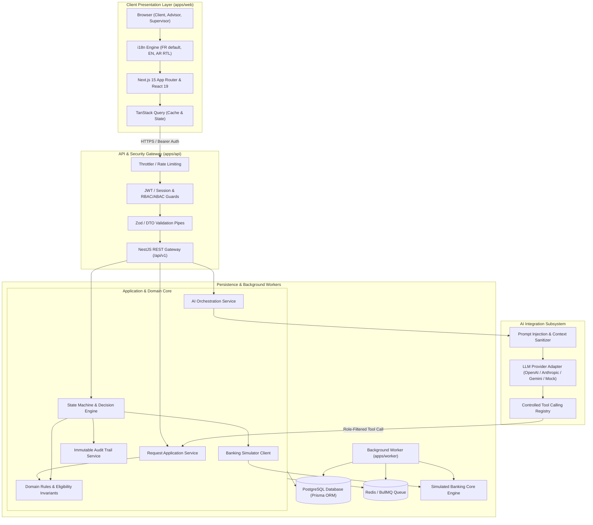
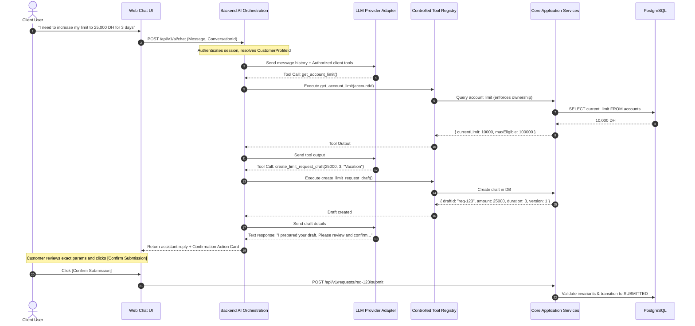

# PROORGA — Technical Architecture Document

## 1. System Overview & Architectural Principles

The PROORGA Banking Workflow Platform is designed as a **Modular Monolith** in a strongly typed TypeScript monorepo. It prioritizes high cohesion, strict domain boundary enforcement, enterprise banking auditability, and defense-in-depth security.

### Core Architectural Principles
1. **Domain-Driven Design (DDD) & Clean Architecture:** Domain entities and business invariants live strictly inside the domain layer. Controllers and UI components contain zero business rules.
2. **Defense-in-Depth Security:** Every HTTP endpoint, service call, and AI tool execution enforces server-side authentication, role authorization, and tenant/resource ownership checks. Frontend UI hiding is never considered a security control.
3. **Optimistic Concurrency & Idempotency:** Financial state transitions and banking simulator activations are protected against race conditions, duplicate clicks, and network retransmissions via monotonic versioning and cryptographic idempotency keys.
4. **Resilient AI Orchestration:** The AI Agent communicates with the platform strictly via typed, authenticated backend tools. The LLM has zero direct database or infrastructure access, and client prompts are treated as untrusted input.

---

## 2. High-Level System Architecture



---

## 3. Monorepo Organization

```text
proorga-ai-banking-agent/
├── apps/
│   ├── web/                    # Next.js 15 App Router frontend application
│   │   ├── src/
│   │   │   ├── app/            # Localized routes ([locale]/dashboard, /requests, etc.)
│   │   │   ├── components/     # UI design system (buttons, tables, modals, badges)
│   │   │   ├── features/       # Feature modules: auth, requests, advisor, supervisor, ai-chat
│   │   │   ├── hooks/          # Custom React hooks (useAuth, useRequestActions)
│   │   │   ├── i18n/           # Translation dictionaries (fr.json, en.json, ar.json) & RTL context
│   │   │   └── lib/            # API client (Axios/Ky), formatting, utilities
│   │   ├── package.json
│   │   └── tsconfig.json
│   │
│   ├── api/                    # NestJS modular backend API
│   │   ├── src/
│   │   │   ├── modules/
│   │   │   │   ├── auth/              # JWT issuance, strategies, password hashing
│   │   │   │   ├── users/             # User accounts and credentials
│   │   │   │   ├── accounts/          # Bank accounts and balances
│   │   │   │   ├── customers/         # Customer profiles and file completeness
│   │   │   │   ├── requests/          # Limit increase request management & DTOs
│   │   │   │   ├── workflow/          # Finite State Machine & decision coordination
│   │   │   │   ├── banking-simulator/ # Deterministic simulator, idempotency, failures
│   │   │   │   ├── documents/         # Uploads, validation, storage
│   │   │   │   ├── ai/                # LLM adapters, tool schemas, safety guards
│   │   │   │   ├── audit/             # Structured audit logging
│   │   │   │   └── health/            # Readiness and liveness endpoints
│   │   │   ├── common/                # Decorators, filters, interceptors, pipes
│   │   │   └── main.ts
│   │   ├── package.json
│   │   └── tsconfig.json
│   │
│   └── worker/                 # Standalone background task processor
│       ├── src/
│       │   ├── processors/     # Expiration processor, retry processor
│       │   └── main.ts
│       ├── package.json
│       └── tsconfig.json
│
├── packages/
│   ├── shared-types/           # TypeScript interfaces, enums, workflow state types
│   └── shared-validation/      # Shared Zod schemas (request rules, limits, credentials)
│
├── prisma/
│   ├── schema.prisma           # Relational schema definition
│   ├── migrations/             # Versioned SQL migrations
│   └── seed.ts                 # Realistic demo data seed script
│
├── docs/                       # Architecture, Requirements, DB, Workflow, Plan
├── docker-compose.yml          # Container configuration (Postgres, Redis, API, Web, Worker)
├── .env.example                # Documented configuration template
├── package.json                # Workspace root package.json (pnpm)
├── pnpm-workspace.yaml
└── README.md
```

---

## 4. Security Architecture

### 4.1 Authentication & Session Handling
- Strong password hashing using `bcrypt` (work factor 12).
- Stateless JWT issuance with standard claims (`sub`, `email`, `role`, `portfolioId`, `teamId`).
- Secure cookie and `Authorization: Bearer <token>` support.
- Short-lived access tokens with automatic renewal options.

### 4.2 Role-Based & Attribute-Based Authorization (RBAC / ABAC)
1. **Role Guard:** Intercepts endpoints based on `@Roles(Role.CLIENT)`, `@Roles(Role.CONSEILLER)`, `@Roles(Role.SUPERVISEUR)`.
2. **Ownership / Tenancy Policy (ABAC):**
   - **Client:** Can strictly access requests where `request.customerProfile.userId === currentUser.id`.
   - **Advisor:** Can strictly access requests belonging to customers assigned to their `portfolioId`.
   - **Supervisor:** Can strictly access escalated requests assigned to their `teamId`.
   - **Separation of Duties:** Enforces `request.decisions.find(d => d.actorId === currentSupervisor.id && d.decisionType === 'RECOMMEND_APPROVAL') === undefined`.

### 4.3 Input Validation & Sanitization
- All HTTP request payloads pass through strict Zod / class-validator pipes with `whitelist: true, forbidNonWhitelisted: true`.
- Zero mass-assignment vulnerability.
- Safe file uploads: MIME type inspection (PDF, PNG, JPEG), 5 MB file size limit, sanitized file names stored outside web root.

---

## 5. AI Architecture & Controlled Tool Calling



### Safety Features of the AI Subsystem:
1. **Dynamic Tool Filtering:** The LLM only receives tools permitted for the caller's role. Advisor tools (`recommend`, `approve`) are omitted when serving a customer.
2. **Explicit User Confirmation Card:** The AI prepares a draft and outputs structured metadata that triggers a dedicated UI Confirmation Card displaying exact values (Amount, Duration, Reason, Target Version). The user must explicitly press a dedicated confirmation action.
3. **Prompt Injection Mitigation:** System prompt instructs the model to ignore any user requests to bypass rules, alter roles, or skip supervisor reviews. All sensitive invariants are re-enforced by the backend domain service regardless of LLM output.

---

## 6. Simulated Banking Service & Idempotent Protocol

The banking simulator simulates external core banking host integration:

1. **Idempotency Key Generation:** Derived as `sha256(requestId + ":" + targetVersion + ":" + action)`.
2. **Deterministic Failure Injection:** Supports header or environment-driven triggers:
   - `SIMULATE_FAILURE=NETWORK_TIMEOUT`: Core activation throws network timeout.
   - `SIMULATE_FAILURE=LOST_ACK`: Core applies limit internally, but socket closes before response delivery.
3. **Idempotent Retry:**
   When a retry is invoked:
   ```typescript
   const existing = await db.bankingActivation.findUnique({ where: { idempotencyKey } });
   if (existing && existing.status === 'SUCCESS') {
     return { success: true, duplicated: false, restored: false, alreadyApplied: true };
   }
   ```
4. **Limit Restoration:** When a limit expires, a restoration job resets the account limit to 10,000 DH and marks the request as `EXPIRED`.

---

## 7. Internationalization (i18n) & Arabic RTL Engineering

1. **Dictionary-Driven:** No hardcoded strings. Managed through hierarchical JSON dictionaries (`apps/web/src/i18n/{fr,en,ar}.json`).
2. **RTL Transformation:**
   - HTML attributes: `<html lang="ar" dir="rtl">`
   - Tailwind logical utilities: `start-0`, `end-0`, `ms-4`, `me-4`, `ps-3`, `pe-3`, `text-start`, `text-end`.
   - Layout mirroring: Sidebar navigates to the right, breadcrumbs read right-to-left.
3. **Locale-Aware Formatting:**
   - Currency: Format using `Intl.NumberFormat(locale, { style: 'currency', currency: 'MAD' })`.
   - Dates: Format using `Intl.DateTimeFormat(locale, { dateStyle: 'medium', timeStyle: 'short' })`.
