# PROORGA — Engineering Implementation Plan

## 1. Phased Roadmap Overview

This implementation plan outlines the sequenced, rigorous execution strategy to deliver the complete, production-grade PROORGA Banking Workflow Platform.

```mermaid
flowchart LR
    P1["Phase 1: Architecture & Specs"] --> P2["Phase 2: Monorepo & Shared Types"]
    P2 --> P3["Phase 3: Backend Core & DB"]
    P3 --> P4["Phase 4: Workflow Engine"]
    P4 --> P5["Phase 5: Simulator & Worker"]
    P5 --> P6["Phase 6: Frontend & UI System"]
    P6 --> P7["Phase 7: i18n & Arabic RTL"]
    P7 --> P8["Phase 8: AI Agent Integration"]
    P8 --> P9["Phase 9: Automated Testing"]
    P9 --> P10["Phase 10: Verification & Docs"]
```

---

## 2. Phase-by-Phase Deliverables

### Phase 1: Planning, Invariants & Architecture Baseline (COMPLETED)
- [x] Read and cross-reference all 6 pages of `CDC-FULL STACK.pdf`.
- [x] Create `docs/REQUIREMENTS.md`.
- [x] Create `docs/ARCHITECTURE.md`.
- [x] Create `docs/DATABASE.md`.
- [x] Create `docs/WORKFLOW.md`.
- [x] Create `docs/IMPLEMENTATION_PLAN.md`.
- [x] Create `TASKS.md` checklist.

### Phase 2: Monorepo & Shared Packages
- Initialize pnpm workspace configuration (`pnpm-workspace.yaml`, root `package.json`).
- Establish `packages/shared-types` with TypeScript enums, DTO interfaces, and API contracts.
- Establish `packages/shared-validation` with shared Zod schemas (credentials, request rules, limits).
- Configure `docker-compose.yml` with PostgreSQL (port 5434), Redis (port 6380), API (port 4001), Web (port 3002).
- Create `.env.example` with documented environment keys.

### Phase 3: Backend Foundation & Data Persistence
- Setup NestJS application in `apps/api`.
- Implement Prisma schema with PostgreSQL models (`User`, `CustomerProfile`, `Account`, `LimitRequest`, `RequestVersion`, `Decision`, `BankingActivation`, `AuditEvent`, `AIConversation`, `AIMessage`).
- Run initial Prisma migration and verify DB connection.
- Implement Authentication Module with JWT, bcrypt password hashing, Passport strategies.
- Implement RBAC and ABAC guards (`@Roles`, `@RequireOwnership`, `@SeparationOfDuties`).
- Create comprehensive seed script with realistic demo data across all three roles.

### Phase 4: Banking Workflow Engine & Domain Invariants
- Implement `RequestsModule` with CRUD and versioning logic.
- Implement `WorkflowService` governing state machine transitions:
  - `createDraft()`, `submitRequest()`, `requestComplement()`, `resubmitRequest()`
  - `recommendApproval()`, `approveRequest()`, `rejectRequest()`, `cancelRequest()`
- Implement optimistic locking and version check on all decision endpoints.
- Implement document upload handling with MIME validation (PDF, PNG, JPG) and 5MB size limit.
- Record immutable `RequestVersion` and `Decision` records for all actions.
- Enforce the single active/in-progress request per account constraint.

### Phase 5: Banking Simulator & Background Processing
- Implement `BankingSimulatorService`:
  - `activateLimit(idempotencyKey, requestId, amount, duration)`
  - `restoreOriginalLimit(requestId)`
  - Deterministic failure modes (`SUCCESS`, `NETWORK_TIMEOUT`, `LOST_ACK`, `BANK_500`)
- Implement `BankingActivation` table logging with idempotency tracking.
- Setup background worker / scheduler:
  - Periodic check for expired active limits (`now >= activeUntil`)
  - Restoration of 10,000 DH transfer limit
  - Endpoint for on-demand simulator trigger and manual expiration replay.

### Phase 6: Frontend & Banking SaaS Design System
- Setup Next.js 15 App Router application in `apps/web`.
- Configure Tailwind CSS with restrained financial color palette (Deep Navy, Slate Gray, Subtle Borders, Muted Accents).
- Build reusable UI primitives: Button, Input, Select, Dialog, Card, Table, Status Badge, Alert, Confirmation Modal.
- Implement Auth context, Protected Routes, and Demo User Switcher.
- Implement **Client Portal**:
  - Accounts overview, current limits, request creation form with dynamic document requirement (> 50k).
  - Request details, timeline history, complement response modal, cancellation button.
- Implement **Advisor Workspace**:
  - Portfolio queue, request review panel, document viewer, Motivated Complement dialog, Direct Approval (≤ 30k), Recommendation dialog (> 30k), Motivated Rejection.
- Implement **Supervisor Workspace**:
  - Escalated requests queue, advisor recommendation review, Motivated Approval, Motivated Rejection, audit trail.

### Phase 7: Internationalization (i18n) & Full Arabic RTL
- Implement custom zero-dependency client i18n solution with translation dictionaries (`fr.json`, `en.json`, `ar.json`).
- Ensure French is the default locale across the entire application.
- Implement full Arabic RTL support:
  - Dynamic `dir="rtl"` and `lang="ar"` on `<html>`.
  - Tailwind logical properties (`ms-*`, `me-*`, `ps-*`, `pe-*`, `start-*`, `end-*`, `text-start`).
  - Correct layout mirroring for navigation, tables, dialogs, and forms.
  - Arabic typography (Noto Sans Arabic / Cairo).
  - Locale-aware currency (`MAD` / `د.م.`) and date formatting via `Intl`.

### Phase 8: AI Assistant with Controlled Tools & Safety
- Implement server-side `AiModule` with provider abstraction (`LlmProvider` interface):
  - Deterministic built-in `MockLlmAdapter` (works out of the box with zero external keys for testing & demo).
  - External `OpenAiAdapter` / `GeminiAdapter` enabled when API keys are configured.
- Define controlled backend tools with strict JSON schemas:
  - `get_account_limit`, `get_customer_file_status`, `get_request_details`, `create_limit_request_draft`, `submit_limit_request`.
- Restrict tool exposure strictly by authenticated session role.
- Implement explicit confirmation card flow: AI prepares draft -> UI shows confirmation modal -> User confirms -> Submit.
- Implement prompt injection safeguards and safety guards.
- Implement conversational persistence (`AIConversation`, `AIMessage`).

### Phase 9: Automated Testing Strategy
- Unit tests: Financial validation rules, duration bounds, document requirements, approval thresholds.
- Integration tests: End-to-end workflow transitions, optimistic locking conflicts, separation of duties.
- Concurrency tests: Concurrent submissions on the same account, concurrent decisions on the same version.
- AI tests: Mock LLM tool calling, prompt injection rejection, graceful degradation on provider failure.
- Acceptance tests: Automated scripts executing all 7 scenarios from Page 6 of the PDF.

### Phase 10: Verification, Documentation & Production Readiness
- Verify clean installation and startup via Docker Compose and local commands.
- Run complete test suite and verify all pass.
- Produce comprehensive, professional `README.md` with:
  - Architecture and workflow diagrams
  - Setup instructions, migrations, seeding
  - Demo credentials for Client, Advisor, and Supervisor
  - API documentation
  - Instructions to replay acceptance scenarios
  - Known limitations and documented assumptions.
