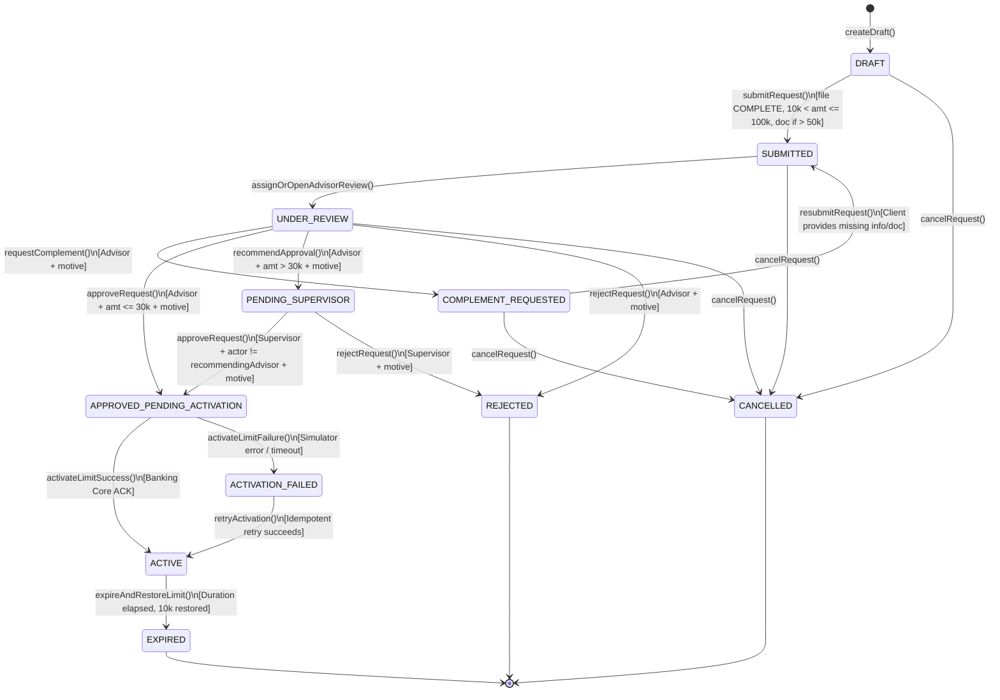

# PROORGA — Banking Workflow & State Machine Engine

## 1. Overview & Core Philosophy

The limit increase request lifecycle is governed by an explicit **Finite State Machine (FSM)**. 

### Key Principles
1. **Explicit Transitions Only:** No generic `PUT /requests/:id` or arbitrary status updates exist. Every transition is an atomic, named domain use case (`submitRequest`, `requestComplement`, `recommendApproval`, `approveRequest`, `rejectRequest`, `cancelRequest`, `activateLimit`, `restoreLimit`, `expireRequest`).
2. **Actor Authorization & Separation of Duties:** Every transition strictly checks the authenticated caller's role, portfolio/team assignment, and ensures that the advisor who formulated a recommendation cannot validate it as a supervisor.
3. **Mandatory Audit & Decision Motives:** Every human intervention (complement request, recommendation, approval, rejection) requires an explicit non-empty motive.
4. **Optimistic Locking:** Every transition command requires the caller's known `targetVersion`. If the request was updated by another actor in the meantime, the command is rejected with `409 Conflict`.

---

## 2. Complete State Machine Diagram



---

## 3. Transition Matrix & Guard Conditions

| From State | To State | Allowed Actor | Trigger Operation | Mandatory Guards & Invariants |
| :--- | :--- | :--- | :--- | :--- |
| `[*] / Initial` | `DRAFT` | Client / AI (on behalf) | `createDraft()` | Client must own account. No other request in `ACTIVE` or in-progress state on this account. |
| `DRAFT` | `SUBMITTED` | Client / AI (post-confirmation) | `submitRequest()` | 1. Customer file status == `COMPLETE`<br>2. `10,000 < requestedLimit ≤ 100,000 DH`<br>3. `1 ≤ durationDays ≤ 7`<br>4. Non-empty `reason`<br>5. If `requestedLimit > 50,000 DH`, at least 1 document attached.<br>6. Account has no other in-flight request. |
| `SUBMITTED` | `UNDER_REVIEW` | Advisor | `openReview()` | Advisor belongs to the assigned customer portfolio. |
| `UNDER_REVIEW` | `COMPLEMENT_REQUESTED` | Advisor | `requestComplement()` | Non-empty motivated comment required explaining what is missing. |
| `COMPLEMENT_REQUESTED` | `SUBMITTED` | Client | `resubmitRequest()` | Client updates parameters or uploads required supporting document. Increments version. |
| `UNDER_REVIEW` | `APPROVED_PENDING_ACTIVATION` | Advisor | `approveRequest()` | `requestedLimit ≤ 30,000 DH`. Mandatory approval motive. Triggers banking simulator activation asynchronously. |
| `UNDER_REVIEW` | `PENDING_SUPERVISOR` | Advisor | `recommendApproval()` | `requestedLimit > 30,000 DH`. Mandatory recommendation motive recorded. |
| `PENDING_SUPERVISOR` | `APPROVED_PENDING_ACTIVATION` | Supervisor | `approveRequest()` | Mandatory approval motive. **Separation of Duties:** Supervisor user ID != Advisor user ID who made the recommendation. |
| `UNDER_REVIEW` or `PENDING_SUPERVISOR` | `REJECTED` | Advisor or Supervisor | `rejectRequest()` | Mandatory rejection motive recorded. No activation can ever follow. |
| `DRAFT`, `SUBMITTED`, `UNDER_REVIEW`, `COMPLEMENT_REQUESTED` | `CANCELLED` | Client | `cancelRequest()` | Only permitted **before** the first decision of approval or rejection. |
| `APPROVED_PENDING_ACTIVATION` | `ACTIVE` | Banking Simulator | `handleActivationSuccess()` | Host acknowledges limit increase. Account `currentTransferLimit` updated to `requestedLimit`. |
| `APPROVED_PENDING_ACTIVATION` | `ACTIVATION_FAILED` | Banking Simulator | `handleActivationFailure()` | External failure logged. Retry allowed using the same idempotency key. |
| `ACTIVATION_FAILED` | `ACTIVE` | Supervisor / Worker Retry | `retryActivation()` | Safe retry with original idempotency key succeeds. |
| `ACTIVE` | `EXPIRED` | Worker / Manual Trigger | `expireRequest()` | `now >= activeUntil`. Account `currentTransferLimit` reset to initial (10,000 DH). |

---

## 4. Separation of Duties Specification

A critical compliance requirement from the assignment:
```typescript
if (request.status === LimitRequestStatus.PENDING_SUPERVISOR) {
  const recommendationDecision = request.decisions.find(
    d => d.decisionType === DecisionType.RECOMMEND_APPROVAL
  );
  
  if (recommendationDecision && recommendationDecision.actorId === currentUserId) {
    throw new ForbiddenException({
      code: 'SEPARATION_OF_DUTIES_VIOLATION',
      message: 'You cannot approve a request that you recommended, even with dual roles.'
    });
  }
}
```

---

## 5. Complement Cycle & Version Immutability

1. When an advisor triggers `requestComplement`, the request transitions to `COMPLEMENT_REQUESTED`.
2. The client is notified in their dashboard and via the AI agent.
3. The client can edit the draft or upload missing files.
4. When resubmitted, the request increments `version = version + 1`, records a new `RequestVersion` snapshot in PostgreSQL, and returns to `SUBMITTED`.
5. The historical decisions and previous versions remain permanently readable for compliance audits.
